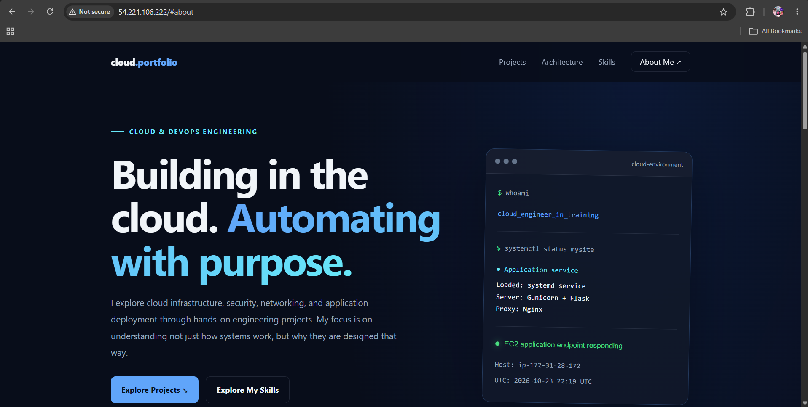
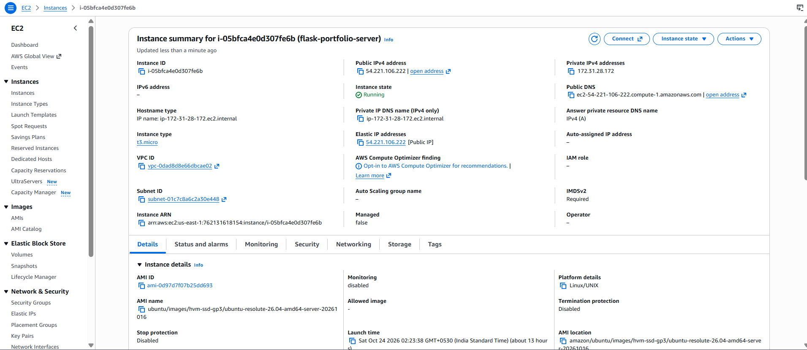
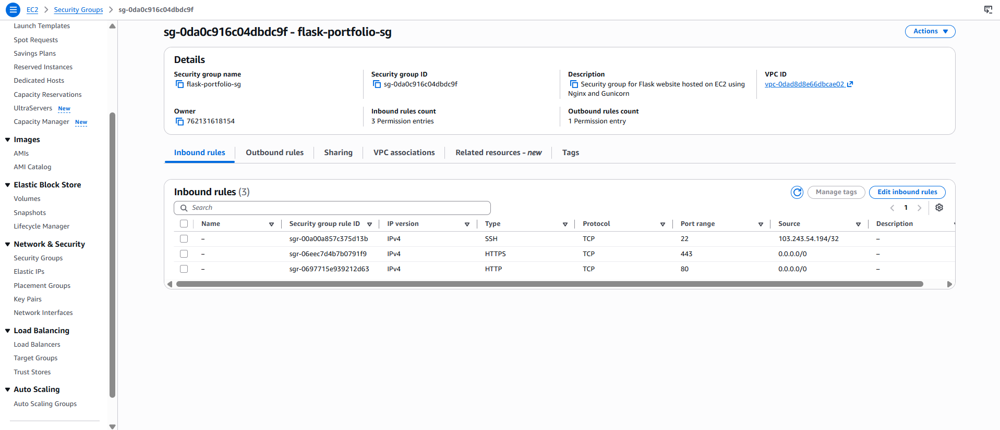

# AWS EC2 Flask Web Application Deployment

A Flask web application deployed on **AWS EC2 using Ubuntu, Gunicorn, Nginx, and systemd**.

This project demonstrates how to deploy and operate a Python web application on a cloud-based Linux server using a reverse proxy, a production WSGI application server, and Linux service management.

Rather than exposing Flask directly to the internet, the deployment uses Nginx to receive HTTP requests and forward them to Gunicorn, which runs the Flask application locally.

## Architecture


### Request Flow

1. A visitor accesses the website through a web browser.
2. The AWS Security Group controls incoming network traffic.
3. Nginx receives HTTP requests on port `80`.
4. Nginx forwards requests to Gunicorn at `127.0.0.1:8000`.
5. Gunicorn runs the Flask application defined in `app.py`.
6. systemd manages the Gunicorn service and is configured to restart it if it fails.
7. The response travels back through Nginx to the visitor's browser.

### Architecture Components

| Component | Responsibility |
|---|---|
| AWS EC2 | Hosts the deployed application |
| Ubuntu Linux | Operating system |
| AWS Security Group | Controls inbound network access |
| Nginx | Reverse proxy and HTTP request handling |
| Gunicorn | WSGI application server |
| Flask | Python web application framework |
| systemd | Service lifecycle management |
| Python virtual environment | Isolates Python dependencies |

## Technology Stack

- **Cloud Platform:** Amazon Web Services (AWS)
- **Compute:** Amazon EC2
- **Operating System:** Ubuntu Linux
- **Programming Language:** Python
- **Web Framework:** Flask
- **WSGI Server:** Gunicorn
- **Reverse Proxy:** Nginx
- **Service Management:** systemd
- **Version Control:** Git and GitHub

## Repository Structure

```text
aws-ec2-flask-deployment/
├── app.py
├── requirements.txt
├── .gitignore
├── systemd/
│   └── mysite.service
├── architecture/
│   └── architecture.png
└── screenshots/
    ├── ec2-instance.png
    ├── security-group-inbound-rules.png
    ├── systemctl-nginx-and-gunicorn.png
    └── website.png
```

## Deployment Implementation

### 1. Flask Application

The web application is implemented in `app.py`.

Its dependencies are listed in `requirements.txt`, allowing the Python environment to be recreated without committing the virtual environment to version control.

### 2. Gunicorn Application Server

Gunicorn serves the Flask application using the `app:app` application reference.

The application server listens on the local loopback interface at port `8000`:

```bash
gunicorn --workers 2 --bind 127.0.0.1:8000 app:app
```

Binding to `127.0.0.1` prevents direct public access to the Gunicorn listener.

### 3. Nginx Reverse Proxy

Nginx listens for incoming HTTP requests on port `80` and forwards them to Gunicorn.

This separates public HTTP request handling from application execution and provides a clear boundary between the reverse proxy and the application server.

### 4. systemd Service Management

The service configuration is stored in `systemd/mysite.service`.

It defines the service user, application working directory, Gunicorn startup command, and restart behavior.

This allows the application service to be managed through systemd rather than requiring Gunicorn to be started manually in an interactive terminal.

## Deployment Evidence

The following screenshots document the deployed environment and its configuration.

### 1. Live Website



The deployed application accessed through the EC2 public address.

### 2. EC2 Instance



Evidence of the EC2 instance used to host the application.

### 3. Security Group Configuration




The inbound network rules used to control access to the EC2 instance.

SSH access should be restricted to trusted source IP addresses. HTTP traffic is permitted on port `80`.

## Network Configuration

| Component | Port / Address | Purpose |
|---|---|---|
| Nginx | `80` | Receives public HTTP requests |
| Gunicorn | `127.0.0.1:8000` | Processes application requests locally |
| SSH | `22` | Remote server administration |
| HTTPS | `443` | Future enhancement; HTTPS is not yet configured |

Port `8000` should not be opened to the public internet because Nginx communicates with Gunicorn over the local interface.

## Validation and Troubleshooting

The following commands can be used to inspect the deployment.

Check Nginx:

```bash
sudo systemctl status nginx --no-pager
```

Check the Gunicorn application service:

```bash
sudo systemctl status mysite --no-pager
```

Test the local HTTP endpoint:

```bash
curl -I http://localhost
```

If the application exposes a health endpoint, test it with:

```bash
curl http://localhost/health
```

A successful HTTP response and active services provide useful evidence that the deployment is functioning correctly.

## Security Considerations

- Gunicorn listens on the loopback interface rather than a public network interface.
- SSH access should be limited to trusted IP addresses.
- The EC2 Security Group controls which inbound ports are accessible.
- The `.gitignore` file excludes the virtual environment, private key files, and environment files.
- Python dependencies are documented separately in `requirements.txt`.
- Private keys, AWS credentials, and other secrets must never be committed to GitHub.

**Current limitation:** The application is served over HTTP. HTTPS has not yet been configured.

## Future Improvements

- Connect a custom domain name.
- Configure HTTPS using a TLS certificate and Nginx.
- Implement structured application logging and monitoring.
- Add automated tests for the Flask application.
- Introduce a CI/CD pipeline for repeatable deployments.
- Add health monitoring and operational alerts.
- Explore infrastructure provisioning through Terraform.

## Key Takeaways

This project demonstrates the practical integration of cloud compute, Linux administration, reverse proxy configuration, WSGI application serving, and process management.

It establishes a foundation for understanding how Python web applications are deployed and operated on AWS EC2 using components with clearly separated responsibilities.
