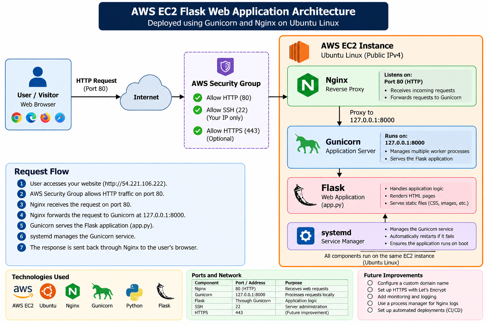

# AWS EC2 Flask Web Application Deployment

A Flask web application deployed on **AWS EC2 using Ubuntu, Gunicorn, Nginx, and systemd**.

This project demonstrates how to deploy and operate a Python web application on a cloud-based Linux server using a reverse proxy, a production WSGI application server, and Linux service management.

Rather than exposing Flask directly to the internet, the deployment uses Nginx to receive HTTP requests and forward them to Gunicorn, which runs the Flask application locally.

## Architecture



### Request Flow

1. A visitor accesses the website through a web browser.
2. The AWS Security Group controls incoming network traffic.
3. Nginx receives HTTP requests on port `80`.
4. Nginx forwards requests to Gunicorn at `127.0.0.1:8000`.
5. Gunicorn runs the Flask application defined in `app.py`.
6. systemd manages the Gunicorn service and is configured to restart it if it fails.
7. The response travels back through Nginx to the visitor's browser.

### Architecture Components

| Component | Responsibility |
|---|---|
| AWS EC2 | Hosts the deployed application |
| Ubuntu Linux | Operating system |
| AWS Security Group | Controls inbound network access |
| Nginx | Reverse proxy and HTTP request handling |
| Gunicorn | WSGI application server |
| Flask | Python web application framework |
| systemd | Service lifecycle management |
| Python virtual environment | Isolates Python dependencies |

## Technology Stack

- **Cloud Platform:** Amazon Web Services (AWS)
- **Compute:** Amazon EC2
- **Operating System:** Ubuntu Linux
- **Programming Language:** Python
- **Web Framework:** Flask
- **WSGI Server:** Gunicorn
- **Reverse Proxy:** Nginx
- **Service Management:** systemd
- **Version Control:** Git and GitHub

## Repository Structure

```text
aws-ec2-flask-deployment/
├── app.py
├── requirements.txt
├── .gitignore
├── systemd/
│   └── mysite.service
├── architecture/
│   └── architecture.png
└── screenshots/
    ├── ec2-instance.png
    ├── security-group-inbound-rules.png
    ├── systemctl-nginx-and-gunicorn.png
    └── website.png
```

## Deployment Implementation

### 1. Flask Application

The web application is implemented in `app.py`.

Its dependencies are listed in `requirements.txt`, allowing the Python environment to be recreated without committing the virtual environment to version control.

### 2. Gunicorn Application Server

Gunicorn serves the Flask application using the `app:app` application reference.

The application server listens on the local loopback interface at port `8000`:

```bash
gunicorn --workers 2 --bind 127.0.0.1:8000 app:app
```

Binding
